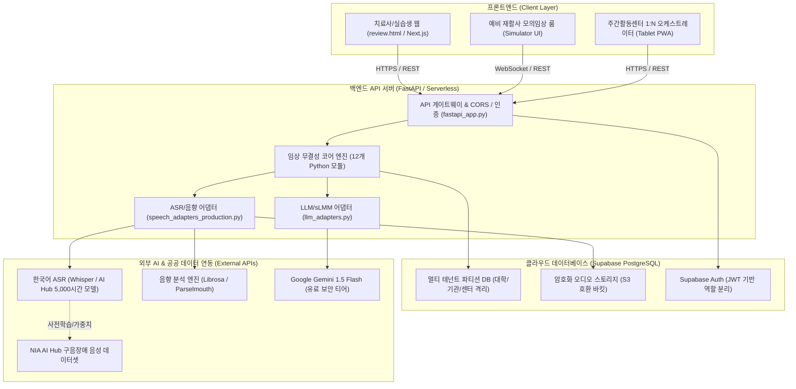

# 유니원 라랩 (Unione Rehab) 클라우드 서버 및 AI API 연동 통합 설계서
**API Server Integration & Production Cloud Architecture Plan**

- **작성 기준일:** 2026-11-01
- **적용 대상:** `slp_platform` (유니원 라랩 임상·실습 및 자립 지원 플랫폼)
- **핵심 목표:** 
  1. Phase 1 (예비 언어재활사 AI 모의임상 B2U) 및 Phase 2 (성인 발달장애 주간활동센터 자립소통 B2G)의 완벽한 기능 수용
  2. Vercel Serverless + Supabase BaaS 기반의 월 15만~25만 원 초경량 원가 통제 구조 실현
  3. 향후 외부 ASR(음성인식), Acoustic(음향분석), LLM(Gemini Flash), sLMM(교구생성) API 실연동 인터페이스 확립

---

## 1. 전체 시스템 아키텍처 다이어그램



---

## 2. 4대 핵심 외부 API 연동 명세

### 2.1. 한국어 ASR (음성인식) API 연동
- **연동 클래스:** `WhisperAPIAdapter` (`backend/app/speech_adapters_production.py`)
- **프로토콜:** REST API / gRPC 스트리밍
- **전송 데이터:** 16kHz 모노 WAV/WebM 오디오 바이너리
- **반환 데이터:** 전사 텍스트(`text`), 신뢰도 점수(`confidence`), 단어별 타임스탬프(`words: [{start, end, word}]`)
- **비용 방어 및 데이터 대안:**
  - 상용 API 호출 전, 과기정통부·NIA AI Hub 『구음장애 음성인식 데이터(1,200명+, 5,000시간+)』 기반 파인튜닝 가중치를 자체 컨테이너로 서빙하여 호출 원가를 $0으로 절감.

### 2.2. 음향 분석(Acoustic Analysis) 파이프라인
- **엔진:** Librosa v0.10+ / Praat Parselmouth
- **추출 지표:**
  1. `Onset & Offset`: 발화 시작 시점 및 종료 시점 (반응 잠재기 `response_latency` 자동 계산)
  2. `Speech Rate`: 초당 음절 수 (Syllables per second)
  3. `Pause Duration & Frequency`: 250ms 이상의 비정상 휴지 구간 탐지
  4. `Voice Stability (Pitch F0 & Jitter/Shimmer)`: 발성 안정성 지표
- **임상 안전 원칙:** 음향 지표는 오직 '관찰값(Observation)'으로만 기록되며, 말더듬이나 마비말장애 진단으로 자동 확정하지 않음.

### 2.3. Google Gemini 1.5 Flash 유료 보안 LLM API 연동
- **연동 클래스:** `GeminiClinicalWriterAdapter` 및 `VirtualPatientSimulator` (`backend/app/llm_adapters.py`)
- **적용 영역:**
  1. 회기 결과보고서(SOAP) 문장화: `metrics_engine`에서 확정된 분자·분모 및 규칙 패턴만을 입력받아 표준 보고서 문장으로 다듬음.
  2. 예비 언어재활사 모의임상 가상환자 대화 생성: 브로카 실어증, 발달장애 등 페르소나별 발화 생성.
- **보안 및 규정 준수:**
  - **Google Cloud 유료 엔터프라이즈 티어 계약:** 전송된 의료·임상 프롬프트 데이터가 구글 기초 모델 학습에 일절 사용되지 않음.
  - **할루시네이션 방지 가드레일:** 시스템 프롬프트에 `STRICT_FACT_ONLY` 지침을 강제하여 제공된 지표 외 임의 수치 생성을 원천 차단.
- **단위 원가:** 1회기당 평균 입력 3,000토큰 + 출력 2,000토큰 기준 **회기당 약 14원 ($0.00975)**.

### 2.4. sLMM 성인 라이프-스킬(Life-Skill) 교구 생성기
- **연동 클래스:** `AdultLifeSkillGenerator` (`backend/app/llm_adapters.py`)
- **도메인:** 키오스크 주문(`kiosk_ordering`), 대중교통 이용(`public_transit`), 마트·편의점 금전 계산(`community_finance`), 직장 소통(`workplace_communication`).
- **출력:** 성인 난이도별 3~5단계 퀘스트, 시각 자극 프롬프트, 사회복지사용 촉구 가이드(Prompting Hierarchy).

---

## 3. 백엔드 서버 및 데이터베이스(BaaS) 구조 전환

### 3.1. FastAPI 서버리스 배포 아키텍처
- 기존 경량 `http.server` 기반 `api.py`를 현대적인 `fastapi_app.py`로 승격 완료.
- **주요 특징:**
  - 비동기 ASGI 이벤트 루프 처리 (`async def`)
  - Pydantic v2 기반 요청/응답 자동 유효성 검증
  - 자동 대화형 API 문서 제공 (`/docs`, Swagger UI / Redoc)
  - Vercel Serverless Function (`api/index.py`) 또는 AWS Lambda 컨테이너로 즉시 배포 가능.

### 3.2. Supabase PostgreSQL 스키마 및 보안 (RLS)
- **테이블 구성:** `schema.sql` 기반 14개 테이블
  - `patients`, `evaluations`, `goals`, `sessions`, `stimuli`, `trials`, `attempts`, `reviews`, `session_plans`, `proposals`, `home_assignments`, `access_logs`, `state_transitions`, `consents`
- **행 수준 보안 (Row Level Security, RLS):**
  - 대학/복지관/센터별 `tenant_id` 격리.
  - 관리자(`admin`)라 하더라도 환자의 세부 임상 의무기록 및 음성 데이터 원문 열람을 DB 정책으로 차단.
  - 실습생 계정(`trainee`)은 `is_approved = TRUE`인 데이터만 수정 가능.

---

## 4. 환경 변수 및 설정 가이드 (.env)

프로덕션 클라우드 배포 시 필요한 환경 변수 템플릿입니다.

```env
# [Server & Environment]
ENV=production
PORT=8000
DEBUG=False
SECRET_KEY=unione-rehab-super-secret-key-2026

# [Supabase BaaS]
SUPABASE_URL=https://your-project.supabase.co
SUPABASE_SERVICE_ROLE_KEY=eyJh...
SUPABASE_JWT_SECRET=your-jwt-secret

# [AI & LLM Services]
GEMINI_API_KEY=AIzaSy...
GEMINI_MODEL=gemini-1.5-flash
OPENAI_API_KEY=sk-proj-... # Whisper STT 백업용

# [Audio & Storage]
AUDIO_STORAGE_BUCKET=clinical-audios-encrypted
AUDIO_MAX_SIZE_MB=25
ALLOWED_AUDIO_FORMATS=audio/wav,audio/webm,audio/ogg
```

---

## 5. 단계별 서버·API 연동 마일스톤

| 단계 | 추진 과제 | 연동 모듈 및 대상 API |
| :--- | :--- | :--- |
| **마일스톤 1 (기반 완료)** | • FastAPI 엔트리포인트 및 어댑터 인터페이스 구축<br>• 모의임상/라이프스킬 엔드포인트 단위 테스트 통과 | `fastapi_app.py`, `speech_adapters_production.py`, `llm_adapters.py` (테스트 20종 통과 완료) |
| **마일스톤 2 (BaaS 연동)** | • Supabase PostgreSQL 인스턴스 생성 및 `schema.sql` 마이그레이션<br>• Vercel Pro 서버리스 배포 및 도메인 연결 | Supabase Auth, PostgreSQL RLS, Vercel Serverless |
| **마일스톤 3 (AI 실엔진 연동)** | • Gemini 1.5 Flash 유료 보안 엔드포인트 연동<br>• NIA AI Hub 5,000시간 구음장애 음성 Whisper 파인튜닝 모델 서빙 | Google GenAI SDK, Faster-Whisper 컨테이너 |
| **마일스톤 4 (현장 파일럿)** | • 대구·경북권 대학 실습실(B2U) 및 성인 주간활동센터(B2G) 현장 연동 | 태블릿 PWA, 마이크 수음 보정, Onset 실측 검증 |
